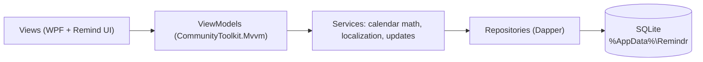

<p align="center">
  
</p>

<p align="center">
  <a href="https://github.com/Randomstufteam/Remindr/releases/latest"></a>
  
  
  <a href="LICENSE"></a>
  <a href="https://randomstufteam.github.io/"></a>
</p>

<p align="center"><b>Everyone gets their own profile, reminders get a picture, and your data never leaves your PC.</b></p>

<p align="center">
  <a href="https://github.com/Randomstufteam/Remindr/releases/latest/download/Remindr-Installer.exe"><b>⬇ Download Remindr-Installer.exe</b></a>
  &nbsp;·&nbsp; v0.5.0 &nbsp;·&nbsp; Windows 10 (2004+) and 11 &nbsp;·&nbsp; 210 MB
  <br><a href="https://randomstufteam.github.io/">🌐 Visit the Remindr website</a>
</p>

> [!WARNING]
> Windows may show **"Windows protected your PC"** because Remindr isn't code-signed yet. Click **More info**, then **Run anyway**.

## What it does

| | |
|---|---|
| 🔔 **Reminders that find you**<br>Windows notifications with Complete, Snooze and Dismiss buttons. | ❗ **Important means it nags**<br>Alerts a day and an hour ahead, then every 10 minutes until you act. |
| 📌 **Runs quietly in the tray**<br>Close the window and alerts still arrive. It can start with Windows too. | 👨‍👩‍👧 **A profile for everyone**<br>A name, a color, one of 176 pictures and an optional 4-digit PIN. |
| 🗓️ **Month, Week and Agenda**<br>Colored dots show each day, and 120 pictures label your reminders. | 🌍 **176 languages**<br>Switched live. Many are machine-translated and may be rough. [Help translate](docs/TRANSLATING.md). |
| ☀️ **A Today page**<br>Overdue, Today, Next 7 days and Important at a glance, plus an optional daily summary. | 🤖 **An offline AI assistant (preview)**<br>Type or say "remind me to call mom friday at 6". It runs on your PC and asks before it changes anything. |
| 🌗 **Remind UI 0.5**<br>Frosted glass, smooth motion and a What's New tour, in Light, Dark or System theme. | 🔄 **Stays up to date**<br>Checks GitHub for new releases and verifies every download before installing it. |

## A look inside

<p align="center">
  
  
</p>
<p align="center">
  
  
</p>

## Install

1. Download **[Remindr-Installer.exe](https://github.com/Randomstufteam/Remindr/releases/latest/download/Remindr-Installer.exe)**.
2. Run it. It installs just for your Windows account, so no admin prompt is needed.
3. Open **Remindr** from the Start menu.

Want to check the file first? Compare this result with `Remindr-Installer.exe.sha256` on the [release page](https://github.com/Randomstufteam/Remindr/releases/latest):

```powershell
Get-FileHash .\Remindr-Installer.exe -Algorithm SHA256
```

To uninstall, use **Settings > Apps > Installed apps**. Your reminders are kept unless you tick **Also remove my data**, and even then they go to the Recycle Bin.

## Privacy

- Everything is stored on your PC in `%AppData%\Remindr`, with no account, no cloud and no tracking.
- The only network request is the optional update check, which sends nothing about you. You can turn it off in **Settings**.
- The AI assistant is off by default and runs entirely on your PC. Its models download only when you ask (from Hugging Face, and the natural voice from GitHub), are checked against a pinned SHA-256, and are stored in `%LocalAppData%\Remindr\models`. What you type or say is never sent anywhere, and voice audio stays in memory and is never saved.
- Profile PINs are hashed (PBKDF2). A 4-digit PIN is a privacy screen for family members, not strong security.

## Languages

All translations were machine-assisted. The 144 languages added in v0.4 are tagged **Machine-translated** in the app, and many are unreviewed and may be rough. If something reads oddly, please [suggest a correction](https://github.com/Randomstufteam/Remindr/issues/new?template=translation.yml), or see [how to translate](docs/TRANSLATING.md).

## Roadmap

Recurring reminders, quick add, search, and the AI assistant in every language.

## For developers

<details>
<summary>How it works</summary>



- **App:** .NET 8 WPF with [WPF-UI](https://github.com/lepoco/wpfui), CommunityToolkit.Mvvm, Dapper and SQLite. Dates are stored as local wall-clock strings, so a 9 AM reminder stays at 9 AM.
- **Installer:** a small .NET Framework 4.8 setup app (already part of Windows) with the self-contained Remindr app appended as its payload. It installs per user and registers itself in Settings > Apps.
- **Logic stays UI-free.** Calendar math, localization and update checks are plain classes with unit tests, ready for a future native rewrite.

</details>

<details>
<summary>Build from source</summary>

You need Windows and the [.NET 8 SDK](https://dotnet.microsoft.com/download/dotnet/8.0).

```powershell
git clone https://github.com/Randomstufteam/Remindr.git
cd Remindr
dotnet build
dotnet test
dotnet run --project src/Remindr
```

To build the installer, run `powershell -File tools\build-installer.ps1`. The output goes to `publish\installer\`.

</details>

## Report a bug or suggest a feature

Use **Settings > Help & feedback** in the app, or open an [issue](https://github.com/Randomstufteam/Remindr/issues/new/choose). The app fills in only your Remindr version and Windows version, never anything personal.

## Credits and license

Remindr is released under the [MIT license](LICENSE). Profile and reminder pictures are [Microsoft Fluent UI Emoji](https://github.com/microsoft/fluentui-emoji) (MIT). See [THIRD-PARTY-NOTICES.md](THIRD-PARTY-NOTICES.md) for all third-party licenses.
