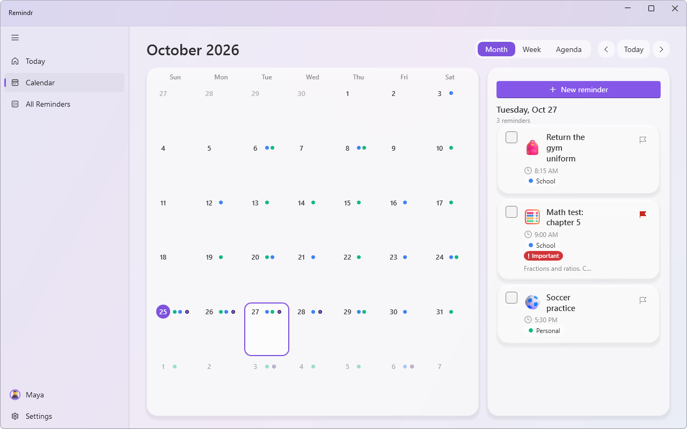
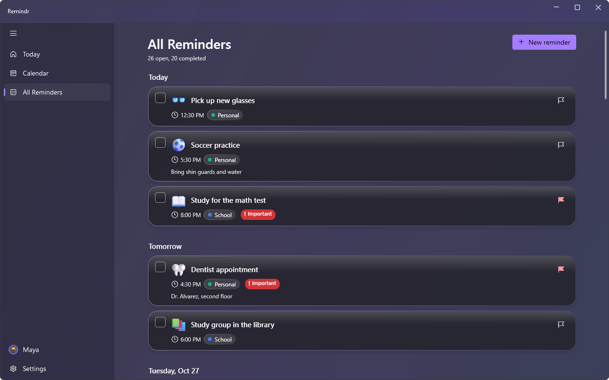
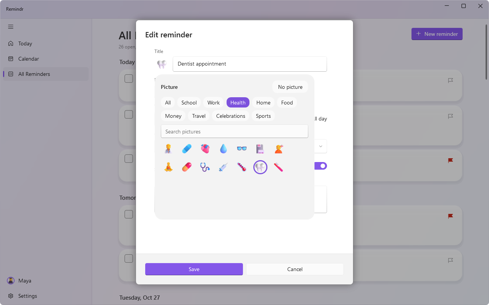
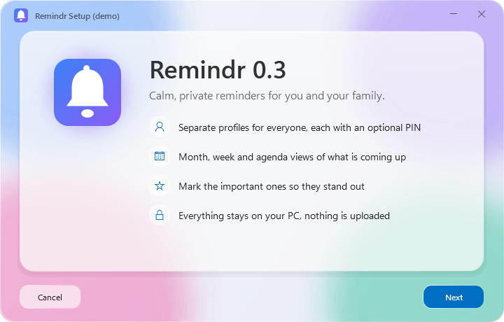
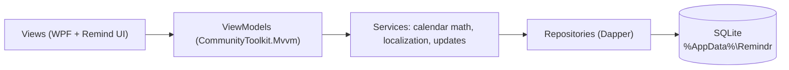

<p align="center">
  
</p>

<p align="center">
  <a href="https://github.com/Randomstufteam/Remindr/releases/latest"></a>
  
  
  <a href="LICENSE"></a>
  <a href="https://randomstufteam.github.io/"></a>
</p>

**Remindr** is a reminders and calendar app for Windows, built for the whole family. Each person gets their own profile (with an optional PIN), their reminders get a picture, and everything sits in a soft, translucent glass interface we call **Remind UI**. It speaks 32 languages, and your data never leaves your PC.

<p align="center">
  <a href="https://github.com/Randomstufteam/Remindr/releases/latest/download/Remindr-Installer.exe"><b>⬇ Download Remindr-Installer.exe</b></a>
  &nbsp;·&nbsp; v0.3.1 &nbsp;·&nbsp; Windows 10 (2004+) and 11 &nbsp;·&nbsp; 94 MB
  <br><a href="https://randomstufteam.github.io/">🌐 Visit the Remindr website</a>
</p>

> [!WARNING]
> **Windows will probably warn you when you run the installer.** You may see a blue screen saying **"Windows protected your PC"**. This happens because Remindr is a new app that isn't code-signed yet (signing certificates cost money), not because something is wrong with it.
> To continue, click **More info**, then **Run anyway**.
> Want to check the file first? Compare its fingerprint with the `Remindr-Installer.exe.sha256` file on the [release page](https://github.com/Randomstufteam/Remindr/releases/latest):
> ```powershell
> Get-FileHash .\Remindr-Installer.exe -Algorithm SHA256
> ```

## A look inside

<p align="center">
  
  
</p>
<p align="center">
  
  
</p>

## What it does

- 👨‍👩‍👧 **A profile for everyone.** Each person picks a name, a color and one of 176 pictures, and can lock their profile with a 4-digit PIN.
- 🗓️ **Month, Week and Agenda views.** Colored dots show what's on each day. Click a day to see it, or double-click to add a reminder.
- 🦷 **Reminders with pictures.** Tag "Dentist" with a tooth and "Math test" with books; there are 120 pictures across School, Work, Health, Home, Food, Money, Travel, Celebrations and Sports.
- ❗ **Important reminders** stand out with a red badge.
- 👋 **A warm welcome.** The first launch greets you in many languages, then sets you up in five short steps.
- 🌍 **32 languages**, switched live without a restart, including full right-to-left layout for Arabic and Hebrew.
- 🌗 **Light, Dark or System theme**, with Remind UI's frosted glass and slowly drifting colors.
- 🔄 **Stays up to date.** Remindr checks GitHub for new releases at startup and verifies every download before installing it.
- 🐞 **Report a bug** straight from Settings.

## Install

1. Download **[Remindr-Installer.exe](https://github.com/Randomstufteam/Remindr/releases/latest/download/Remindr-Installer.exe)**.
2. Run it. If Windows shows **"Windows protected your PC"**, click **More info**, then **Run anyway** (see the warning above for why).
3. Follow the installer. It installs just for your Windows account, so no admin prompt is needed.
4. Open **Remindr** from the Start menu.

Remindr shows up in **Settings > Apps > Installed apps**, where you can uninstall it. Uninstalling keeps your reminders unless you tick **Also remove my data**, and even then they go to the Recycle Bin.

## Privacy

- Everything is stored on your PC in `%AppData%\Remindr`. Remindr has no account, no cloud and no tracking.
- The only network request is the optional update check, which asks GitHub's public API for the latest version number and sends nothing about you. You can turn it off in **Settings**.
- Profile PINs are hashed (PBKDF2). A 4-digit PIN is a privacy screen for family members, not strong security.

## Languages

English, Español, Français, Deutsch, Italiano, Português (Brasil), Português (Portugal), Nederlands, Polski, Svenska, Norsk bokmål, Dansk, Suomi, Čeština, Magyar, Română, Ελληνικά, Türkçe, Русский, Українська, Bahasa Indonesia, Tiếng Việt, Filipino, العربية, עברית, हिन्दी, বাংলা, ไทย, 日本語, 한국어, 简体中文, 繁體中文.

Translations were machine-assisted. If something reads oddly, please [suggest a correction](https://github.com/Randomstufteam/Remindr/issues/new?template=translation.yml), or see [how to translate](docs/TRANSLATING.md).

## How it works



- **App:** .NET 8 WPF with [WPF-UI](https://github.com/lepoco/wpfui), CommunityToolkit.Mvvm, Dapper and SQLite. Dates are stored as local wall-clock strings, so a 9 AM reminder stays at 9 AM.
- **Installer:** a small .NET Framework 4.8 setup app (already part of Windows) with the self-contained Remindr app appended as its payload. It installs per user and registers itself in Settings > Apps.
- **Logic stays UI-free.** Calendar math, localization and update checks are plain classes with unit tests, ready for a future native rewrite.

## Build from source

You need Windows and the [.NET 8 SDK](https://dotnet.microsoft.com/download/dotnet/8.0).

```powershell
git clone https://github.com/Randomstufteam/Remindr.git
cd Remindr
dotnet build
dotnet test
dotnet run --project src/Remindr
```

To build the installer, run `powershell -File tools\build-installer.ps1`. The output goes to `publish\installer\`.

## Report a bug or suggest a feature

Use **Settings > Help & feedback** in the app, or open an [issue](https://github.com/Randomstufteam/Remindr/issues/new/choose). The app fills in only your Remindr version and Windows version, never anything personal.

## Roadmap

These aren't in v0.3 yet:

- Windows notifications for due reminders, with snooze, and extra nudges for Important ones
- A tray icon, background running and an option to start with Windows
- Recurring reminders (daily, weekly, monthly, yearly)
- Quick add ("Math test friday 9am !"), search and category management
- A Today dashboard with a daily summary
- An optional, fully offline AI assistant you can talk to
- Later: a native C++ / WinUI 3 version

## Credits and license

Remindr is released under the [MIT license](LICENSE). Profile and reminder pictures are [Microsoft Fluent UI Emoji](https://github.com/microsoft/fluentui-emoji) (MIT). See [THIRD-PARTY-NOTICES.md](THIRD-PARTY-NOTICES.md) for all third-party licenses.
